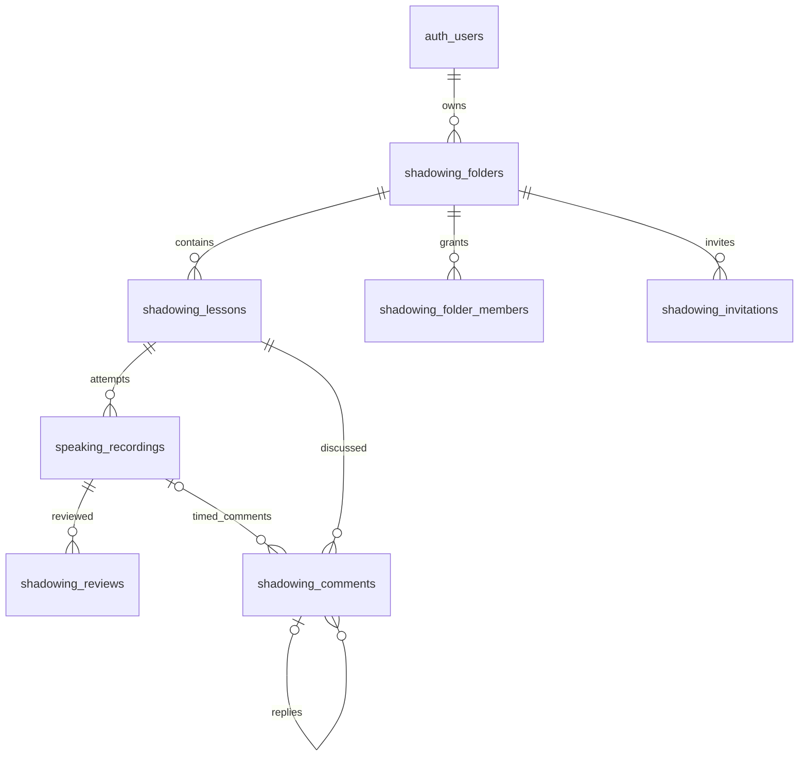

# Shadowing folders and future collaboration

Run `007_speaking_recordings.sql` first, then `008_shadowing_library.sql` in Supabase SQL Editor. Migration 008 is transactional and rerunnable. It backfills existing uploaded recordings into one initial lesson per recording under an owner's default folder; audio files are not moved/deleted. Local-only legacy recordings remain visible in the old-recording bucket until assigned a folder.

## Data model

- `shadowing_folders`: owner, name, optional Drive folder ID for future per-folder media sharing.
- `shadowing_lessons`: title/reference text separate from recordings. An owned folder is mandatory for new lessons. One lesson can have many attempts. Moving a lesson changes its folder, preserving attempts and their original text snapshots.
- `speaking_recordings`: existing private file metadata + `lesson_id`; local IndexedDB retains the audio blob. Recordings are still explicitly uploaded with Lưu lên Drive.
- `shadowing_folder_members`: membership per folder, viewer/reviewer roles, optional future Drive permission ID. Only owner manages membership.
- `shadowing_invitations`: invited email, role, inviter, expiration/status, optional token hash. No plaintext invite token is stored. The accept/revoke flows and email delivery are not implemented yet.
- `shadowing_reviews`: one review per reviewer and recording, optional 0-100 score, feedback, draft/submitted status.
- `shadowing_comments`: lesson discussion and optional recording/time marker, with threaded replies. Composite foreign keys ensure a recording belongs to that lesson and a parent comment belongs to the same lesson.

## Roles

| Operation | Owner | Reviewer | Viewer | Outsider |
|---|---|---|---|---|
| Read shared folders/lessons/record metadata | Yes | Yes | Yes | No |
| Create/edit/move lessons and manage folders | Yes | No | No | No |
| Manage members/invitations | Yes | No | No | No |
| Write own review/comment | Yes | Yes | No | No |
| Edit another person's review/comment | No | No | No | No |

RLS uses fixed-search-path security-definer boolean helpers to avoid membership recursion. Revoking membership removes access to metadata/comments/reviews. Folder/lesson ownership is checked by composite foreign keys. Current UI loads only owned folders; invitation/review/comment UI will be added later. No invitations are sent by this feature.

## Drive access is separate

Membership in Supabase does not grant access to a private Google Drive file. Before implementing reviewer playback, add an explicit Drive permission flow for invited Google accounts, or an authenticated streaming service. The nullable `drive_folder_id` and `drive_permission_id` reserve room for that mapping. Current uploads continue to use the existing private app folder; changing a lesson's app folder does not move Drive files or grant any sharing permissions.

## Current UI and synchronization

Speaking list shows folders (create/rename/filter), one entry per lesson, an attempt count and expandable recordings. Folder selector moves a lesson with its attempts. Practice requires folder/title/text, allows saving a lesson without recording and reuses the lesson ID for repeated attempts. Folder/lesson writes are saved to account-scoped IndexedDB first, then sent to Supabase. Failed writes remain pending; reopening Speaking, coming online or clicking Làm mới retries. Writes run in order with Web Locks when supported. Concurrent in-flight edits are not acknowledged as saved until their actual values have been sent.

Vocab sync/import/export continue to operate only on vocabulary tables. They do not clear shadowing lessons or audio. Shadowing files live in Drive and metadata lives in the separate tables above.

## Recording deletion

Run `migrations/010_delete_speaking_recordings.sql` after migration 009. Recording cards have a confirmation dialog for deletion. For uploaded recordings, the app checks database access, permanently deletes the Drive file, then deletes Supabase metadata and local audio. Recording-linked comments and reviews cascade; the lesson remains available for another attempt. Only the recording owner can delete it.

Deletion progress is retained locally if a step fails. Use the continue-delete action to retry; once Drive deletion has succeeded, retries skip that step. A failed Drive request keeps metadata and local audio available. This spans Drive and Supabase and is not an atomic cross-service transaction.

Lesson cards also offer confirmed deletion. The app fetches all cloud attempts with pagination, merges local attempts, deletes their Drive files and metadata using the same retry flow, then deletes the lesson and its discussion. The folder remains. Lesson deletion is serialized with library synchronization. Existing migration 008 provides lesson delete permission; uploaded attempts also require migration 010. If a new recording arrives concurrently, the foreign key blocks lesson deletion until that attempt is removed on retry.

## Verification

`server/shadowing-storage.test.mjs` tests folder validation/ownership, lesson folder changes and multiple attempts, and legacy compatibility. `server/shadowing-sql.test.mjs` uses a local PGlite/PostgreSQL engine with a simulated auth.uid() and roles: verifies migration reruns/backfill and owner/viewer/reviewer/outsider policies, including revocation. This is not a live Supabase deployment or Google Drive permission test.
